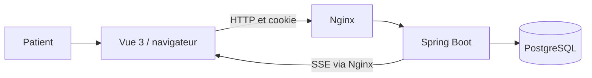

# Architecture de MediSlot

## Vue d'ensemble

Le patient cherche un praticien et réserve un rendez-vous depuis son navigateur, qui exécute l'application Vue. Nginx sert les fichiers statiques et transmet tout ce qui commence par `/api` au monolithe Spring Boot, lequel applique les règles métier et parle à PostgreSQL. Il n'y a aucun vrai prestataire de santé ni service d'e-mail derrière : le SMS de confirmation part vers une petite passerelle Python de démonstration (`sms-passerelle/serveur.py`).

Les diagrammes complets (architecture, classes, séquence de réservation) sont dans `docs/diagrammes/`.

## Découpage du back

Le code est rangé par couches, sous `backend/src/main/java/fr/medislot` :

- `api` reçoit les requêtes, valide les DTO et construit les réponses.
- `application` contient les cas d'usage : réserver, annuler, déplacer, chacun dans une transaction (`BookingService`).
- `domain` regroupe les entités JPA.
- `repository` : Spring Data JPA, avec les verrous pessimistes de PostgreSQL (`lockById`).
- `security` configure les routes protégées, l'identité et le CSRF.
- `realtime` envoie les signaux SSE une fois la transaction validée et nettoie les connexions mortes.
- `geo` porte la recherche par proximité : `NearbyQuery` pour les bornes, `NearbyService` pour le tri et la pagination, et deux implémentations de `NearbyFinder`. `BoxNearbyFinder` (boîte englobante puis distance de Haversine) est active par défaut, `PostgisNearbyFinder` seulement avec le profil Spring `postgis`.
- `document` génère la convocation en PDF.

On pourrait regrouper le métier en modules `directory`, `booking`, `identity` et `notification`. Ce n'est pas fait ici : la correction reste volontairement en couches, et la séance 9 te propose de réfléchir à ce redécoupage vers un monolithe modulaire. Ne cherche pas non plus une architecture hexagonale complète, elle n'y est pas.

## Règles qui doivent toujours être vraies

Un créneau a au plus un rendez-vous `CONFIRMED`. Le patient vient toujours de la session et jamais du corps de la requête. Une annulation conserve l'historique. Un déplacement vérifie d'abord le nouveau créneau, puis remplace l'ancien dans la même transaction. Quand il faut verrouiller deux créneaux, on les prend dans l'ordre croissant de leurs identifiants, sinon deux déplacements croisés finiraient en interblocage.

## Données

Les tables sont `app_user`, `professional`, `slot`, `appointment`, `audit_event` et `notification`. La référence, c'est le schéma versionné par Flyway dans `backend/src/main/resources/db/migration` (`V1__schema.sql`, puis `V2__geoloc.sql` pour latitude et longitude). Avec PostGIS, une `V3__postgis.sql` s'ajoute dans `db/postgis` et crée une colonne `location` indexée en GiST. Les DTO de réponse sont séparés des entités, et les clés étrangères gardent les références cohérentes. L'index unique partiel `one_active_appointment_per_slot` garantit l'unicité du rendez-vous confirmé même si un autre chemin de code oublie de prendre le verrou.

## Performance

Les recherches sont paginées, triées par `name` puis `id` pour que l'ordre reste stable d'une page à l'autre (par distance, puis nom, puis id pour la recherche de proximité). Les créneaux ont un index `(professional_id, starts_at)`. Côté front, les cartes interrogent les disponibilités en parallèle, au plus six à la fois. Un endpoint groupé, des projections ou une temporisation des rafraîchissements SSE sont des pistes, mais à ne retenir qu'après une mesure : chaque optimisation que tu ajoutes doit se justifier par une observation, pas par une intuition.
